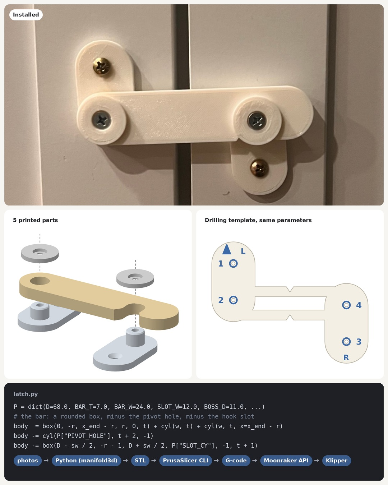
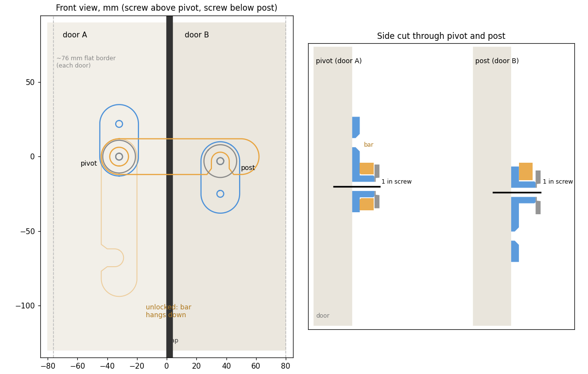

# Pantry flip-bar lock

A 3D-printed flip-bar lock that ties two cabinet-style pantry doors together to keep a toddler out. The whole thing is parametric Python: every part and the drilling template come from one set of numbers.

> **Not a safety device.** This is an untested hobby print, not a certified child-safety product. PLA can creep, crack or fail under load. Use it at your own risk, check it regularly, and don't rely on it to keep a child away from anything dangerous.



## How it works

| Part | What it does |
|---|---|
| **Base** (left door) | Plate with a round boss the bar pivots on |
| **Bar** | Flips down; its downward-open hook drops over the post |
| **Keeper** (right door) | Plate with the post the hook sits on |
| **Washers** ×2 | Sit under the pivot and post screw heads and keep the bar on |
| **Spacers** (optional) | 1.5 / 3 mm, for doors whose fronts aren't level with each other |
| **Template** | 0.6 mm sheet: lines up on the gap, four holes to mark the screw positions |

- **Locked:** the bar lies across the gap with its hook over the post, so neither door can swing open.
- **Unlocked:** lift the hook off the post and let the bar hang down.
- **No print-in-place hinges:** the bar turns on a screw through a printed boss with about 0.5 mm of clearance, so nothing can fuse during printing.
- **Strength:** every part prints flat, so the load runs along the extrusion lines rather than across layer bonds.



## Generate the parts

```bash
cd prints/pantry-flip-lock
python3 -m venv .venv && .venv/bin/pip install -r requirements.txt
.venv/bin/python latch.py        # -> stl/base.stl, bar.stl, keeper.stl, washer.stl, shim_*.stl
.venv/bin/python template.py     # -> stl/template.stl (+ docs/template.png)
```

Every dimension is a parameter in `latch.py`. Override any of them with JSON:

```bash
.venv/bin/python latch.py '{"BAR_T": 8, "D": 72}'
.venv/bin/python template.py     # the template reads the same parameters, so it always matches
```

| Parameter | Default | Meaning |
|---|---|---|
| `D` | 68 | Pivot-to-post distance (mm) |
| `BAR_T` / `BAR_W` | 7 / 24 | Bar thickness / width |
| `SLOT_W` | 12 | Hook slot width (the post is 11 mm, giving ±0.5 mm play) |
| `PLATE_T` | 4 | Plate thickness |
| `SCREW_PITCH` | 22 | Pivot/post to plate screw distance |
| `HOLE_D` / `CSK_D` | 4.6 / 8.8 | Screw clearance hole / countersink (#8 or #6) |

`render.py` and `exploded.py` redraw the images in `docs/`.

## Printing

PLA. Everything prints flat with no supports.
- **Lock parts:** 0.28 mm layers, 4 perimeters, 30 % gyroid infill. About 2 h, 24 g for bar + base + keeper + 2 washers.
- **Template:** 0.2 mm layers. About 16 min.

## Hardware

Four flat-head wood screws, #8 (or #6):
- 2 × **⅝"** through the plates (template dots 1 and 3).
- 2 × **1"** through a washer and the pivot or post (dots 2 and 4).

This assumes doors at least ⅝" thick. Use pilot holes in MDF.

## Install

1. Tape the template across the gap with the V notches over the gap, the arrow up and **L** on the left door. Mark dots 1–4.
2. **Left door:** screw 1 (⅝"), then the bar on the boss, a washer on top, and screw 2 (1").
3. **Right door:** screw 3 (⅝"), snug but not tight. Hook the bar over the post so the keeper swings into line, then fit screw 4 (1") through the washer and post.
4. If the bar rubs or sits crooked because one door sits forward, put a spacer under the lower plate.

## How it was made

Designed with [Claude Code](https://claude.com/claude-code) as a parametric CSG model using [manifold3d](https://github.com/elalish/manifold) and [trimesh](https://github.com/mikedh/trimesh). It was sliced with the PrusaSlicer CLI and printed on an Ender-3 Pro running Klipper, with jobs uploaded and monitored through the Moonraker API.

## License

MIT. See [LICENSE](../../LICENSE).
